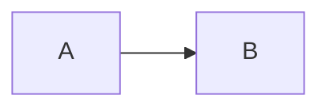

# vitepress-pele

VitePress plugin that renders Mermaid code fences as SVG diagrams with [Pele](https://github.com/sxzz/pele), including optional zoom in the browser.

## Install

```bash
npm install vitepress-pele
```

`pele` is installed automatically. VitePress already provides `markdown-it`.

## Setup

### 1. Markdown (build time)

In `.vitepress/config.ts`:

```ts
import { defineConfig } from 'vitepress';
import { peleMarkdown } from 'vitepress-pele';

export default defineConfig({
  markdown: {
    config(md) {
      md.use(peleMarkdown());
    },
  },
});
```

### 2. Client (zoom + styles)

In `.vitepress/theme/index.ts`:

```ts
import { definePeleDiagram } from 'vitepress-pele/client';
import DefaultTheme from 'vitepress/theme';

import 'vitepress-pele/style.css';

export default {
  extends: DefaultTheme,
  enhanceApp() {
    definePeleDiagram();
  },
};
```

### 3. Write diagrams

````md

````

## Options

### `peleMarkdown(options?)`

| Option      | Default          | Description                                                                                |
| ----------- | ---------------- | ------------------------------------------------------------------------------------------ |
| `maxWidth`  | `688`            | Max diagram width in CSS pixels                                                            |
| `languages` | `['mermaid']`    | Fence languages to render                                                                  |
| `render`    | `{}`             | Extra Pele render options (`idPrefix`, `maxWidth`, and `responsive` are set by the plugin) |
| `onError`   | `'throw'`        | `'throw'` raises `PeleMarkdownError`; `'render'` emits an HTML error block                 |
| `source`    | `false`          | When `true`, sets `data-pele-source` on `<pele-diagram>`                                   |
| `className` | `'pele-diagram'` | Class on `<pele-diagram>`                                                                  |

### `definePeleDiagram(options?)`

| Option | Default          | Description                                                            |
| ------ | ---------------- | ---------------------------------------------------------------------- |
| `tag`  | `'pele-diagram'` | Custom element tag to register                                         |
| `zoom` | Pele defaults    | Pele zoom options (zoom is enabled when the diagram was shrunk to fit) |

## Exports

| Import                     | Purpose                                             |
| -------------------------- | --------------------------------------------------- |
| `vitepress-pele`           | `peleMarkdown`, `PeleMarkdownError`, option types   |
| `vitepress-pele/client`    | `definePeleDiagram`                                 |
| `vitepress-pele/style.css` | Theme styles (maps VitePress CSS variables to Pele) |

## Development

```bash
vp install
vp test
vp pack
```

## License

MIT
