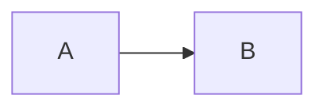

# vitepress-pele

VitePress plugin that renders Mermaid code fences as SVG diagrams with [Pele](https://pele.run/), including optional zoom in the browser.

## Packages

| Path                                                 | Description                          |
| ---------------------------------------------------- | ------------------------------------ |
| [`packages/vitepress-pele`](packages/vitepress-pele) | Publishable `vitepress-pele` library |
| [`apps/docs`](apps/docs)                             | Documentation site (VitePress)       |

## Install

```bash
npm install vitepress-pele pele
```

`pele` is a peer dependency. VitePress already provides `markdown-it`.

## Setup

### 1. Markdown (build time)

In `.vitepress/config.ts`:

```ts
import { defineConfig } from 'vitepress';
import { peleMarkdown } from 'vitepress-pele';

export default defineConfig({
  markdown: {
    config(md) {
      md.use(peleMarkdown());
    },
  },
});
```

### 2. Client (zoom + styles)

In `.vitepress/theme/index.ts`:

```ts
import { definePeleDiagram } from 'vitepress-pele/client';
import DefaultTheme from 'vitepress/theme';

import 'vitepress-pele/style.css';

export default {
  extends: DefaultTheme,
  enhanceApp() {
    definePeleDiagram();
  },
};
```

### 3. Write diagrams

````md

````

## Documentation

See the guide and live examples in [`apps/docs`](apps/docs), or run the docs site locally:

```bash
vp install
vp run docs#dev
```

`docs#dev` / `docs#build` pack `vitepress-pele` first so `dist/` exists for the workspace dependency.

## Development

```bash
vp install
vp test
vp -C packages/vitepress-pele pack
vp run docs#dev
```

## License

MIT
