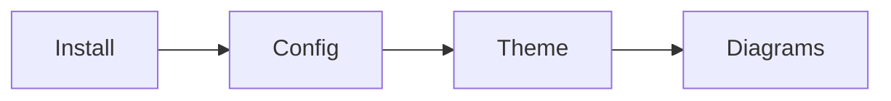
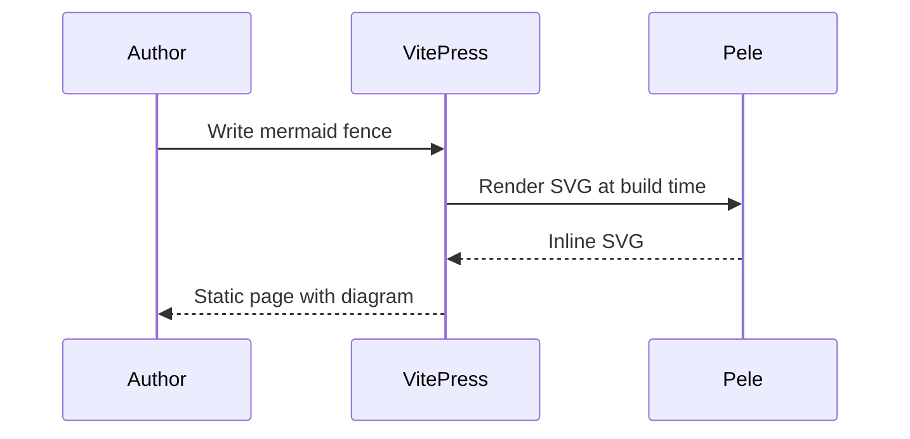
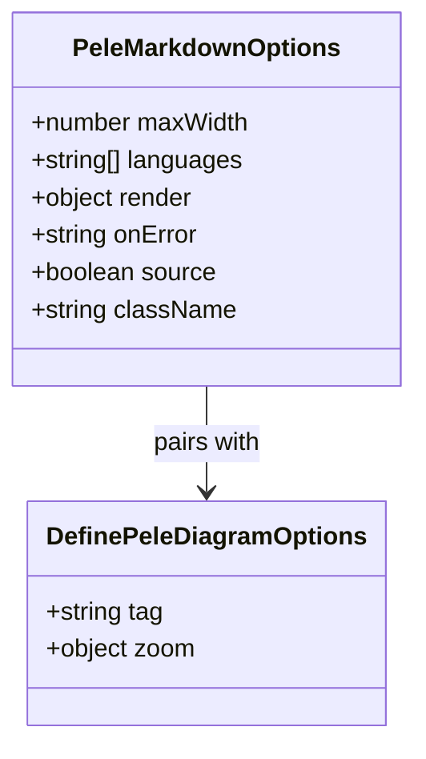
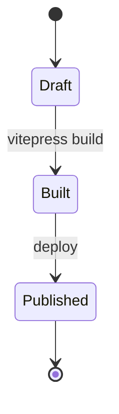

# Live diagrams

These pages use the local `vitepress-pele` workspace package. Diagrams are SVG at build time; zoom is available when a diagram is scaled to fit.

## Flowchart

## Sequence

## Class diagram

## State diagram

