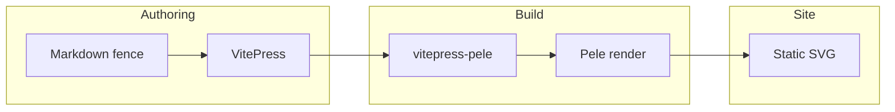

# Examples

These pages render Mermaid through the local `vitepress-pele` package. Diagrams are SVG in the built HTML. Zoom is available when a diagram is scaled to fit. Use **View markdown** under a diagram to copy the fence that produced it.

For every diagram type Pele supports, see [pele.run/examples](https://pele.run/examples).

## Browse

| Page                             | Covers                                               |
| -------------------------------- | ---------------------------------------------------- |
| [Flowchart](/examples/flowchart) | Subgraphs, decisions, edge styles                    |
| [Sequence](/examples/sequence)   | Actors, activation, notes, links                     |
| [Structure](/examples/structure) | Class, ER, state, C4                                 |
| [Charts](/examples/charts)       | Gantt, pie, sankey, mindmap, timeline, quadrant      |
| [Advanced](/examples/advanced)   | Frontmatter config, git graph, packet, kanban, block |

## Quick sample

