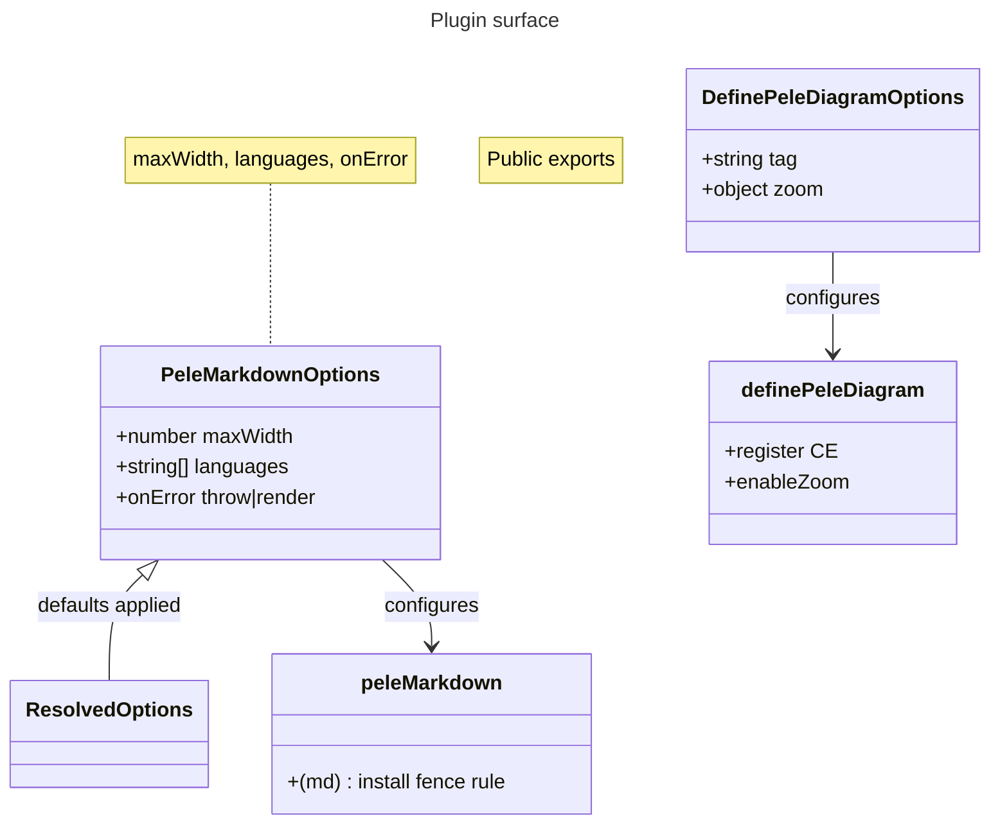
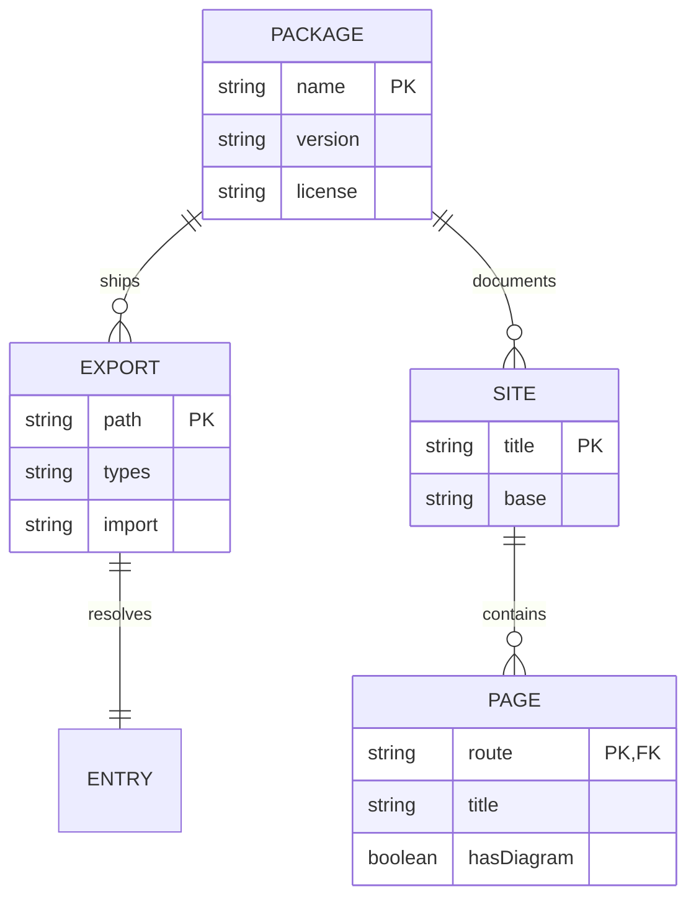
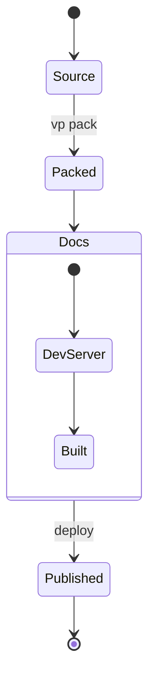
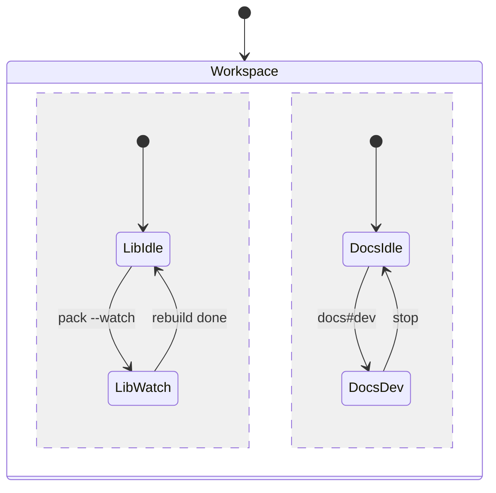

# Structure

## Class



## Entity relationship



## State



## Nested parallel states



## C4 component

```mermaid
C4Component
title Component diagram for a VitePress docs site with Pele

Container(browser, "Reader browser", "HTML/CSS/JS", "Loads the static docs site and optional Pele zoom.")
Container(ci, "CI runner", "GitHub Actions", "Builds and deploys the docs on each push.")
ContainerDb(cdn, "Static host", "Object storage / CDN", "Serves the built HTML, assets, and inline SVG.")
System_Ext(npm, "npm registry", "Hosts the published vitepress-pele package.")

Container_Boundary(docs, "Docs app") {
  Component(vp, "VitePress", "Static site generator", "Parses markdown and builds pages.")
  Component(plugin, "vitepress-pele", "markdown-it plugin", "Turns mermaid fences into Pele SVG at build time.")
  Component(theme, "Theme enhanceApp", "Vue theme hook", "Registers pele-diagram and enables zoom.")
  Component(pele, "Pele", "Diagram renderer", "Layouts Mermaid into SVG.")

  Rel(vp, plugin, "md.use")
  Rel(plugin, pele, "render")
  Rel(theme, plugin, "imports client + CSS")
}

Rel_Back(browser, theme, "Loads", "HTTPS")
Rel(browser, cdn, "Fetches pages", "HTTPS")
Rel(ci, docs, "vp run docs#build")
Rel(ci, cdn, "Uploads dist")
Rel(docs, npm, "workspace / published package")
```
