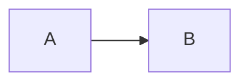

# Getting Started

VitePress plugin that renders Mermaid code fences as SVG diagrams with [Pele](https://pele.run/), including optional zoom in the browser.

## Install

```bash
npm install vitepress-pele pele
```

`pele` is a peer dependency. VitePress already provides `markdown-it`.

## Setup

### 1. Markdown (build time)

In `.vitepress/config.ts`:

```ts
import { defineConfig } from 'vitepress';
import { peleMarkdown } from 'vitepress-pele';

export default defineConfig({
  markdown: {
    config(md) {
      md.use(peleMarkdown());
    },
  },
});
```

### 2. Client (zoom + styles)

In `.vitepress/theme/index.ts`:

```ts
import { definePeleDiagram } from 'vitepress-pele/client';
import DefaultTheme from 'vitepress/theme';

import 'vitepress-pele/style.css';

export default {
  extends: DefaultTheme,
  enhanceApp() {
    definePeleDiagram();
  },
};
```

### 3. Write diagrams

Use a Mermaid fence in any markdown page:

````md

````

That renders as:


## Exports

| Import                     | Purpose                                             |
| -------------------------- | --------------------------------------------------- |
| `vitepress-pele`           | `peleMarkdown`, `PeleMarkdownError`, option types   |
| `vitepress-pele/client`    | `definePeleDiagram`                                 |
| `vitepress-pele/style.css` | Theme styles (maps VitePress CSS variables to Pele) |

## Next steps

- See all plugin options in [Options](/guide/options).
- Browse live examples on [Demos](/demos/).
