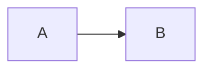

# Getting Started

`vitepress-pele` turns Mermaid code fences into SVG at build time using [Pele](https://pele.run/).

## Install

```bash
npm install vitepress-pele pele
```

`pele` is a peer dependency. VitePress already provides `markdown-it`.

## Setup

### 1. Markdown

In `.vitepress/config.ts`:

```ts
import { defineConfig } from 'vitepress';
import { peleMarkdown } from 'vitepress-pele';

export default defineConfig({
  markdown: {
    config(md) {
      md.use(peleMarkdown());
    },
  },
});
```

### 2. Client

In `.vitepress/theme/index.ts`:

```ts
import { definePeleDiagram } from 'vitepress-pele/client';
import DefaultTheme from 'vitepress/theme';

import 'vitepress-pele/style.css';

export default {
  extends: DefaultTheme,
  enhanceApp() {
    definePeleDiagram();
  },
};
```

`definePeleDiagram()` registers `<pele-diagram>` and wires up Pele zoom. It is a no-op during VitePress SSR when `customElements` is missing.

Zoom is available only when a diagram was shrunk to fit `maxWidth` (default `688`). Diagrams that already fit are shown at full size with no zoom controls.

### 3. Write a diagram

````md

````

That renders as:


## How it works

1. At build time, `peleMarkdown` finds `mermaid` fences and replaces them with Pele SVG inside `<pele-diagram>`.
2. Wide diagrams scale down to `maxWidth`. Narrow ones stay at their natural size.
3. In the browser, `definePeleDiagram` turns on zoom only for diagrams that were scaled down.

## Exports

| Import                     | Purpose                                           |
| -------------------------- | ------------------------------------------------- |
| `vitepress-pele`           | `peleMarkdown`, `PeleMarkdownError`, option types |
| `vitepress-pele/client`    | `definePeleDiagram`                               |
| `vitepress-pele/style.css` | Maps VitePress CSS variables to Pele              |

## Next

- [Options](/guide/options) for `maxWidth`, errors, and zoom
- [Examples](/examples/) for live Mermaid in this docs site
